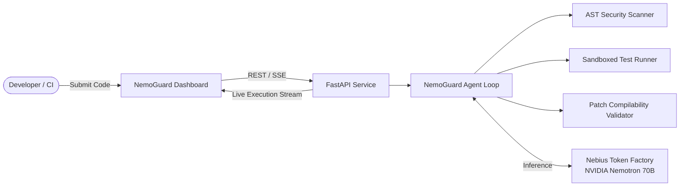

# NemoGuard 🛡️
### Autonomous Agentic Vulnerability Remediation & Verification Engine
**Built for the Nebius × NVIDIA Global AI Hackathon**

[](LICENSE)
[](https://python.org)
[](https://build.nvidia.com)
[](https://tokenfactory.nebius.com/)

---

## 🚀 Overview

**NemoGuard** is an end-to-end autonomous agentic engineering platform that discovers software vulnerabilities, synthesizes reproduction test cases, generates unified code patches, and verifies fixes in a sandboxed runner.

Powered by **NVIDIA Llama-3.1-Nemotron-70B-Instruct** running on **Nebius Token Factory**, NemoGuard demonstrates genuine agentic reasoning with closed-loop verification, moving far beyond simple conversational chatbots.

---

## 🎯 Target Users & Problem Statement

Modern development teams spend critical engineering hours debugging security vulnerabilities, concurrency flaws, and regressions. Existing linters only point out symptoms, while generic LLMs hallucinate non-compiling fixes that break peripheral systems.

**NemoGuard solves this by:**
1. Performing static AST security scanning.
2. Formulating a structured multi-step plan using NVIDIA Nemotron 70B.
3. Generating reproduction test cases to prove the flaw.
4. Synthesizing unified patches and validating compilability.
5. Verifying that the generated patch passes the reproduction test without introducing regressions.
6. Presenting transparent, real-time agent execution telemetry to the developer.

---

## 🧠 NVIDIA Open-Source Model & Nebius Integration

- **Model Used**: `nvidia/Llama-3.1-Nemotron-70B-Instruct-HF`
- **Model Role**: Serves as the core reasoning engine driving the autonomous ReAct (Reason + Act) loop, generating structured tool invocations, code explanations, and unified patches.
- **Inference Platform**: **Nebius Token Factory** (`https://api.tokenfactory.nebius.com/v1/`) provides high-throughput GPU inference over an OpenAI-compatible REST API.
- **Offline / Local Mode**: Includes a deterministic mock client allowing developers to run full unit and integration tests locally without GPU memory bottlenecks or live API credentials.

---

## 🏗️ Architecture



---

## 🛠️ Technology Stack

- **Backend**: Python 3.12, FastAPI, Pydantic, Uvicorn
- **AI Core**: NVIDIA Nemotron-70B, Nebius Token Factory Client, Custom Sandboxed Tools
- **Frontend**: Responsive Single-Page Dashboard (HTML5, Vanilla JS, Modern CSS)
- **Testing**: Pytest, Asyncio, HTTPX

---

## ⚡ Quickstart & Installation

### 1. Prerequisites
- Python 3.10 or higher
- Git
- Nebius Token Factory API Key (Optional for mock mode)

### 2. Clone the Repository
```bash
git clone https://github.com/YOUR-USERNAME/nemoguard.git
cd nemoguard
```

### 3. Setup Virtual Environment
```bash
# Windows
python -m venv venv
venv\Scripts\activate

# Linux / macOS
python3 -m venv venv
source venv/bin/activate
```

### 4. Install Dependencies
```bash
pip install -r requirements.txt
```

### 5. Configure Environment Variables
```bash
cp .env.example .env
```
Edit `.env`:
- To run locally without API credentials, set `AI_EXECUTION_MODE=mock`.
- To run with live Nebius Token Factory inference, set `AI_EXECUTION_MODE=remote` and set `NEBIUS_API_KEY=your_key_here`.

### 6. Run the Application
```bash
python scripts/run_dev.py
```
Open your browser to `http://localhost:8000`.

---

## 🧪 Running Tests

All unit and integration tests run offline on CPU:
```bash
python scripts/run_tests.py
```

---

## 👥 Team & Responsibilities

- **Developer A**: Frontend Dashboard (`apps/web/`), API Routes (`services/api/`), Integration Testing.
- **Developer B**: Model Client (`ai/model_client.py`), Agent Orchestration (`ai/agent.py`), Tool Suite (`ai/tools/`).

See [docs/team-workflow.md](docs/team-workflow.md) for full branch strategy and collaboration protocol.

---

## 📄 License

This project is licensed under the Apache 2.0 License - see the [LICENSE](LICENSE) file for details.
