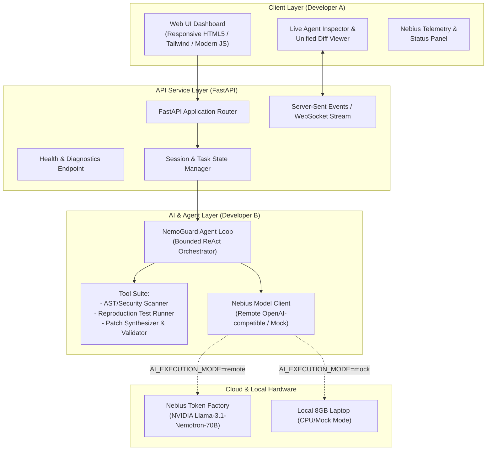

# NemoGuard: System Architecture



---

## 1. Directory Structure

```text
nvdia_project/
├── apps/
│   └── web/                     # Frontend Web Dashboard (Dev A)
│       ├── index.html           # Single-page modern reactive dashboard
│       ├── static/
│       │   ├── css/style.css    # Clean modern styling (dark/light themes)
│       │   └── js/app.js        # SSE streaming, diff rendering, telemetry
├── services/
│   └── api/                     # Backend API Service (FastAPI)
│       ├── __init__.py
│       ├── main.py              # Application entrypoint & routes
│       ├── schemas.py           # Pydantic models & validation schemas
│       └── session.py           # In-memory execution state & streaming queue
├── ai/                          # AI Core & Orchestration (Dev B)
│       ├── __init__.py
│       ├── model_client.py      # Nebius Token Factory & Mock Client
│       ├── agent.py             # Multi-step Agent with loop controls
│       ├── prompts/             # System prompts & schema templates
│       │   └── system_prompt.py
│       └── tools/               # Agent tools
│           ├── __init__.py
│           ├── security_scanner.py
│           ├── test_runner.py
│           └── patch_validator.py
├── shared/                      # Shared types & utilities
│   ├── __init__.py
│   └── config.py                # Environment configuration & settings
├── tests/
│   ├── unit/                    # Unit tests (CPU only, mock enabled)
│   │   ├── test_model_client.py
│   │   ├── test_security_scanner.py
│   │   └── test_patch_validator.py
│   └── integration/             # End-to-end workflow tests
│       └── test_workflow.py
├── docs/                        # Architecture & hackathon documentation
├── scripts/                     # Helper run and test scripts
│   ├── run_dev.py               # One-command server start
│   └── run_tests.py             # One-command test suite runner
├── .env.example
├── .gitignore
├── LICENSE
└── README.md
```

---

## 2. Interface Contracts

### 2.1 API Request & Response Schemas

#### `POST /api/v1/analyze`
Starts an asynchronous agentic analysis job.
```json
// Request
{
  "code": "def process_user(data):\n    query = f'SELECT * FROM users WHERE id = {data[\"id\"]}'\n    return db.execute(query)",
  "language": "python",
  "task_description": "Audit security and generate verified parameterized patch",
  "options": {
    "auto_verify": true,
    "max_iterations": 5
  }
}

// Response (202 Accepted)
{
  "task_id": "task_abc123",
  "status": "QUEUED",
  "created_at": "2026-10-27T18:00:00Z"
}
```

#### `GET /api/v1/stream/{task_id}` (Server-Sent Events)
Streams real-time agent execution events to the frontend:
- `AGENT_THOUGHT`: The model's reasoning step.
- `TOOL_CALL`: Tool being invoked with arguments.
- `TOOL_RESULT`: Tool execution output.
- `PATCH_GENERATED`: Generated unified diff.
- `VERIFICATION_RESULT`: Sandbox test and validation status.
- `TASK_COMPLETED`: Final summary with telemetry (tokens, duration, model).

#### `GET /api/v1/health`
Health check reporting system status, model configuration, and mode (remote vs mock).
```json
{
  "status": "healthy",
  "execution_mode": "mock",
  "model_id": "nvidia/Llama-3.1-Nemotron-70B-Instruct-HF",
  "nebius_connected": true
}
```

---

## 3. Resilience & Guardrails

1. **Deterministic Mock Mode**: Default execution mode (`mock`) allows local testing without requiring Nebius credentials or internet access.
2. **Loop Iteration Bounding**: Agent execution is strictly bounded to `MAX_AGENT_ITERATIONS` (default: 5) to prevent infinite loops and runaway token costs.
3. **Execution Timeouts**: All tool invocations and remote API calls enforce strict 30-second timeouts.
4. **Sandboxed AST Analysis**: Local code execution is isolated, and destructive actions are forbidden (`ALLOW_DESTRUCTIVE_ACTIONS=false`).
